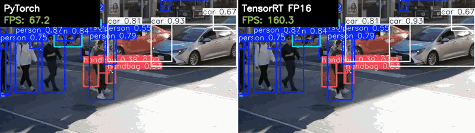
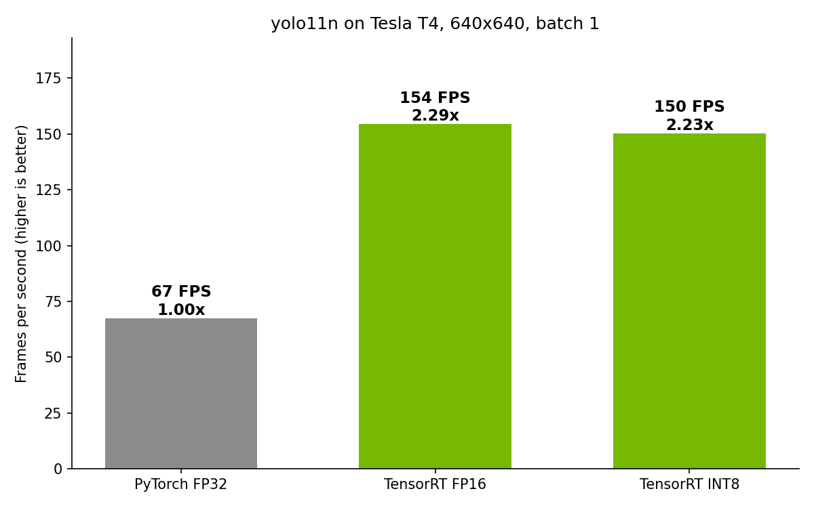

# Real-Time Object Detection with NVIDIA TensorRT

Accelerating YOLO11 object detection **2.29x** on an NVIDIA T4 GPU with TensorRT FP16 (67.5 → 154.4 FPS) with no meaningful accuracy loss, verified with GPU-synchronized benchmarks, mAP accuracy checks, and a side-by-side video demo.

*Left: PyTorch FP32. Right: TensorRT FP16. Same model, same frames, live FPS counters. Full-length video: [results/demo_side_by_side.mp4](results/demo_side_by_side.mp4).*

## What I did

- Built a baseline of the pretrained **YOLO11n** detector in **PyTorch (FP32)** on a real video at 640x640.
- Compiled the same model into **TensorRT engines** at **FP16** and **INT8** (INT8 calibrated on coco128).
- Benchmarked every version the same way: identical inputs, 10 warm-up frames skipped, **GPU-synchronized timing**.
- Checked accuracy (**mAP50-95 / mAP50** on coco128) to measure what the speedup costs.
- Produced a **side-by-side demo video** with live FPS counters.

## Results

Tesla T4 (Google Colab), YOLO11n, 640x640, batch size 1.

| Version | FPS | Speedup vs. PyTorch | Model inference (ms) | mAP50-95 | mAP50 |
|---|---|---|---|---|---|
| PyTorch FP32 (baseline) | 67.5 | 1.00x | 11.57 | 0.508 | 0.675 |
| **TensorRT FP16** | **154.4** | **2.29x** | **3.53** | 0.505 | 0.675 |
| TensorRT INT8 | 150.2 | 2.23x | 3.76 | 0.483 | 0.657 |

FPS is end-to-end per frame (pre-processing, inference and post-processing; video decoding not included), averaged over the whole video after warm-up. Model inference is the neural network alone. mAP is measured on coco128. Those images come from the COCO training set, so the absolute scores run high; compare the versions with each other, not with published COCO numbers. Raw files: [results/results.md](results/results.md), [results/results.csv](results/results.csv).

**Key takeaways**

- **FP16 is the clear winner:** 2.29x faster end to end and 3.3x faster model inference (11.57 → 3.53 ms), with mAP50-95 down only 0.003 and mAP50 unchanged.
- **INT8 did not beat FP16 here:** it was about 3% slower and lost 0.025 mAP50-95. For a model this small at batch size 1, INT8 has little to gain over FP16 and costs some accuracy (see below).
- **The network is no longer the main cost:** with TensorRT FP16, each frame takes about 6.5 ms and the network accounts for only 3.5 ms of that. The rest is pre-processing and post-processing, which TensorRT doesn't speed up.

## What I learned

**What TensorRT does.** TensorRT is NVIDIA's inference compiler. It takes a trained network and builds an "engine" tuned for one specific GPU. It fuses layers (for example convolution + activation) so data makes fewer trips to memory, removes work that is only needed during training, and benchmarks several kernel implementations per layer, keeping the fastest one for that hardware.

**Why FP16 and INT8 are faster.** Lower-precision numbers are smaller, so more of them fit in cache and less memory bandwidth is needed to move them. They also run on **Tensor Cores**, hardware built for fast low-precision matrix math. On a T4, FP16 and INT8 Tensor Core throughput is far higher than FP32. That is where the 3.3x drop in FP16 model inference time comes from.

**Why INT8 wasn't faster than FP16 in this project.** Lower precision only helps when the math is the bottleneck. YOLO11n is tiny, and at batch size 1 the FP16 engine already finishes in about 3.5 ms. At that point, launching kernels and converting data between INT8 and FP16 (layers that don't run well in INT8 stay in higher precision) take up much of the time. INT8 pays off more with larger models, bigger batches, or higher resolutions.

**Why accuracy can drop.** Fewer bits means coarser numbers. FP16 is precise enough for inference: mAP50 didn't change at all. INT8 has only 256 levels per value, so TensorRT uses a calibration dataset (here, only 128 images) to choose a scale for each layer. Values outside the calibrated range get clipped and small differences get rounded away. That shifts box positions and confidence scores slightly, and here it cost 0.025 mAP50-95 (about 5% relative).

**Why the end-to-end speedup (2.29x) is smaller than the model speedup (3.3x).** TensorRT accelerates the neural network itself. Pre-processing and NMS post-processing still run in Python/PyTorch and take about 3 ms per frame in every version. Once the network is fast, that fixed overhead becomes about half of each frame and caps the overall gain. The next step would be moving pre- and post-processing onto the GPU (for example with NVIDIA DeepStream or TensorRT's NMS plugin).

## How to run it

1. Open `yolo_tensorrt_benchmark.ipynb` in [Google Colab](https://colab.research.google.com/) (File > Upload notebook).
2. Select a GPU: **Runtime > Change runtime type > T4 GPU**.
3. Upload a video named **`video.mp4`** using the folder panel on the left.
4. **Runtime > Run all.** The run takes roughly 10-20 minutes, and `results.zip` downloads at the end.

To run outside Colab (Linux + NVIDIA GPU): `pip install -r requirements.txt`, and make sure `ffmpeg` is installed.

## Environment

| Component | Version |
|---|---|
| GPU | Tesla T4 (Google Colab, free tier) |
| NVIDIA driver | 580.82.07 |
| Python | 3.13.15 |
| PyTorch | 2.11.0+cu130 |
| CUDA (PyTorch build) | 13.0 |
| TensorRT | 11.4.0.106 |
| Ultralytics | 8.4.183 |
| OpenCV | 4.14.0 |
